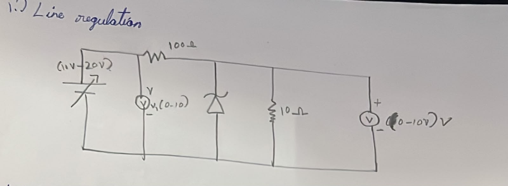
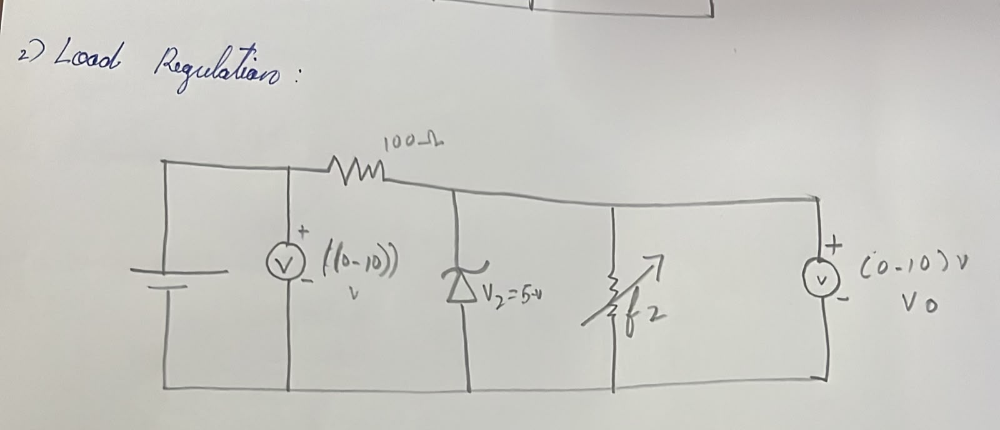
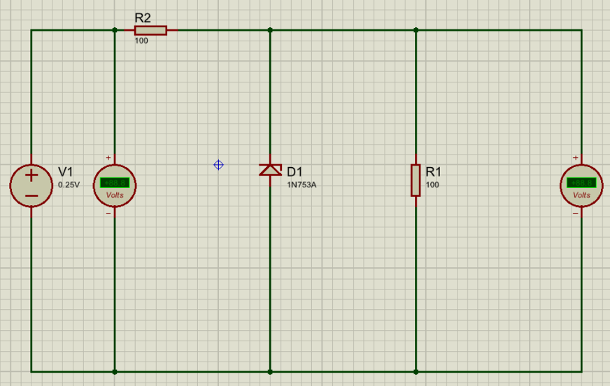
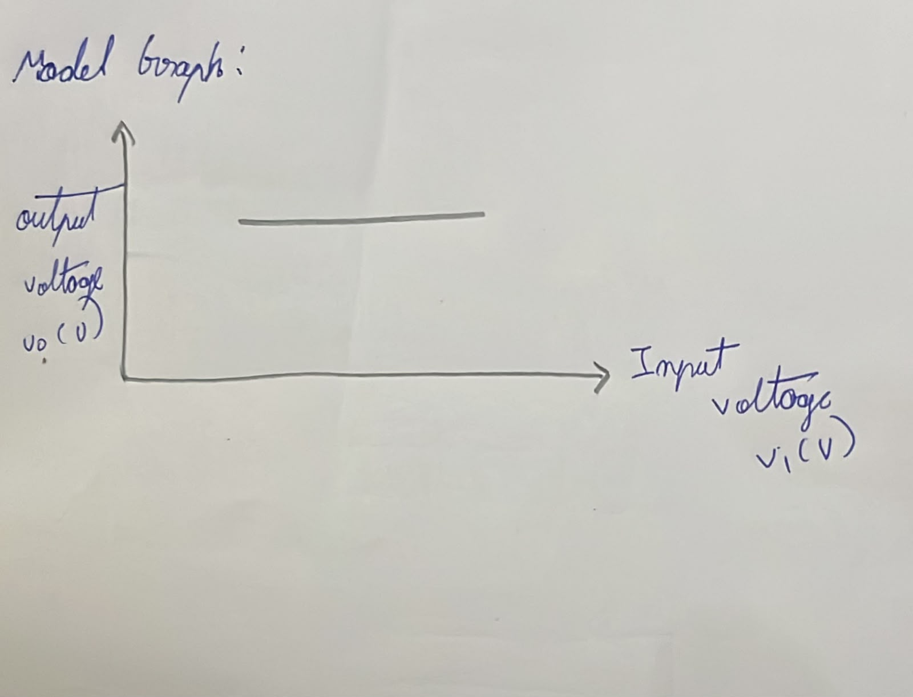
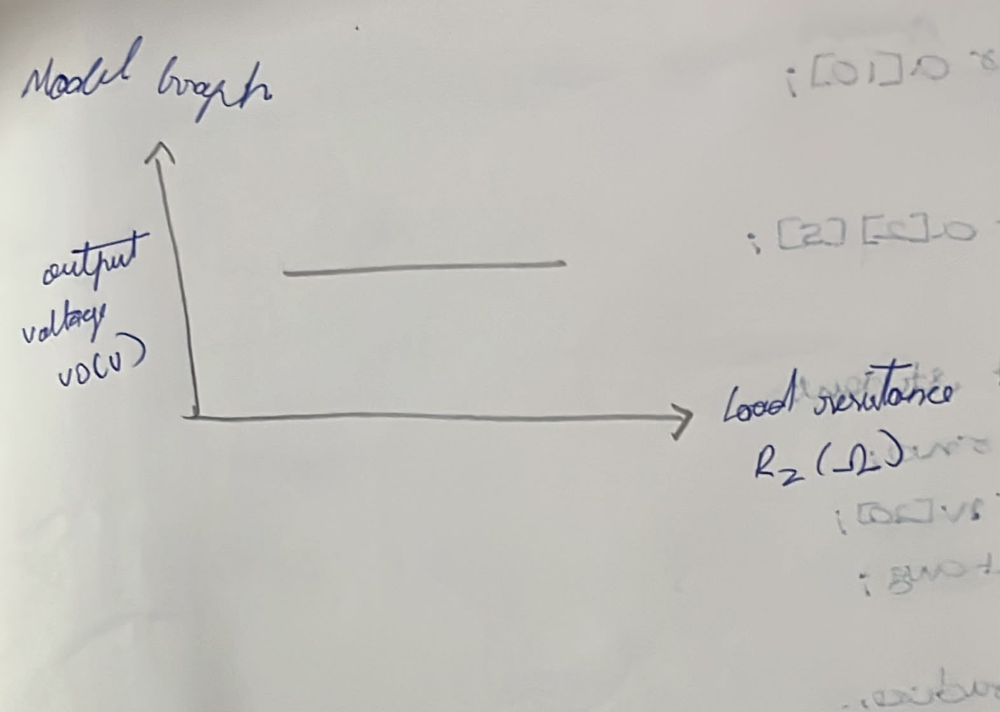

# EXPERIMENT NO. 5 – ZENER DIODE AS VOLTAGE REGULATOR

| **Name:Pravin Kumar P | | **Reg. No.:26018258 | |
|---|---|---|---|
| **Date:22/11/2026 | | **Batch / Section:26ODJ088 | |

---

## AIM

To study the Zener diode as a voltage regulator and to obtain its line regulation and load regulation characteristics.

## APPARATUS REQUIRED

| S. No. | Name of the apparatus | Range | Quantity |
|:---:|:---:|:---:|:---:|
| 1 | Zener diode | 1N4735A | 1 |
| 2 | Resistors | 1 kΩ, 10 kΩ | 1 each |
| 3 | Regulated power supply | (0–30) V DC | 1 |
| 4 | Breadboard | — | 1 |
| 5 | Digital ammeter | (0–200) mA | 1 |
| 6 | Digital voltmeter | (0–20) V DC | 1 |
| 7 | Decade resistance box (load RL) | — | 1 |
| 8 | Connecting wires | — | As required |
| 9 | Simulation software | Proteus Design Suite | 1 |

## THEORY

A Zener diode is a heavily doped p-n junction diode, specially made to operate in the breakdown region. When reverse biased beyond a particular voltage, called the Zener breakdown voltage (Vz), it starts conducting heavily. Once it conducts, it maintains an almost constant voltage across its terminals whatever the current through it, i.e. it has a very low dynamic resistance. A series resistor Rs is connected to limit the current, since a high current can permanently damage the device.

In a Zener voltage regulator, the Zener diode is connected in reverse bias in parallel with the load, and the series resistor Rs is connected between the supply and the load. Any change in input voltage or load current changes the Zener current, while the output voltage across the load stays nearly constant at Vz.

**Line regulation:** the ability of the regulator to keep the output voltage constant when the input voltage varies, with the load kept constant.

**Load regulation:** the ability of the regulator to keep the output voltage constant when the load resistance (load current) varies, with the input voltage kept constant.

## PRECAUTIONS

1. While doing the experiment, do not exceed the ratings of the Zener diode; this may damage the diode.
2. Connect the voltmeter and ammeter in correct polarities as shown in the circuit diagram.
3. Do not switch ON the power supply unless the circuit connections have been checked as per the circuit diagram.

## PROCEDURE

### A. Line regulation

1. Connections are made as per the line regulation circuit diagram, with a fixed load resistance RL.
2. Vary the regulated power supply (input) voltage Vin in steps.
3. For each input voltage, note the output voltage Vo across the load and tabulate the readings.
4. Plot a graph of input voltage Vin (x-axis) versus output voltage Vo (y-axis).

### B. Load regulation

1. Connections are made as per the load regulation circuit diagram.
2. Set the input voltage Vin to a constant value above the Zener voltage.
3. Note the no-load output voltage VNL with the load disconnected.
4. Connect the load and vary the load resistance RL in steps; note the output voltage Vo for each value and tabulate the readings.
5. Plot a graph of load resistance RL (x-axis) versus output voltage Vo (y-axis).

## CIRCUIT DIAGRAM

### A. Line regulation

**Figure 1:** Zener voltage regulator – line regulation

### B. Load regulation

**Figure 2:** Zener voltage regulator – load regulation

## SIMULATION USING PROTEUS

Build the Zener regulator circuit in Proteus using the 1N4735A, the series resistor and the load. Vary the input voltage (line regulation) and the load resistance (load regulation), and paste screenshots showing the meter readings.

### A. Line regulation – simulation

**Figure 3:** Proteus simulation – line regulation

### B. Load regulation – simulation

**Figure 4:** Proteus simulation – load regulation

## TABULATION

### A. Line regulation (RL = 100 Ω, constant)

| S. No. | Input voltage Vin (V) | Output voltage Vo (V) |
|:---:|:---:|:---:|
| 1 |+12.0|+5.14 |
| 2 |+13.0 |+5.16 |
| 3 |+14.0 |+5.17 |
| 4 |+15.0 |+5.17 |
| 5 |+16.0 |+5.18 |
| 6 |+17.0 |+5.19 |

### B. Load regulation (Vin =15V, constant; VNL = 5.2V after disconnecting VR1)

| S. No. | Load resistance RL (Ω) | Output voltage Vo (V) |
|:---:|:---:|:---:|
| 1 | 100 Ω| +5.19|
| 2 | 200 Ω|+5.20 |
| 3 | 300 Ω| +5.20|
| 4 | 400 Ω|+5.20 |
| 5 | 500 Ω| +5.20|
| 6 | 600 Ω|+5.21 |

## FORMULAE

- **% Line regulation = (ΔVo / ΔVin) × 100**
- **% Load regulation = (VNL − VFL) / VFL × 100**
- **Series resistance Rs = (Vin − Vz) / (Iz + IL)**

ΔVo – change in output voltage; ΔVin – change in input voltage; VNL – no-load output voltage; VFL – full-load output voltage; Vz – Zener voltage; Iz – Zener current; IL – load current.

## MODEL GRAPH

### A. Line regulation (Vin vs Vo)

**Figure 5:** Line regulation characteristics

### B. Load regulation (RL vs Vo)

**Figure 6:** Load regulation characteristics

## RESULT

Thus, the Zener diode was used as a voltage regulator, and its line regulation and load regulation characteristics were obtained.
